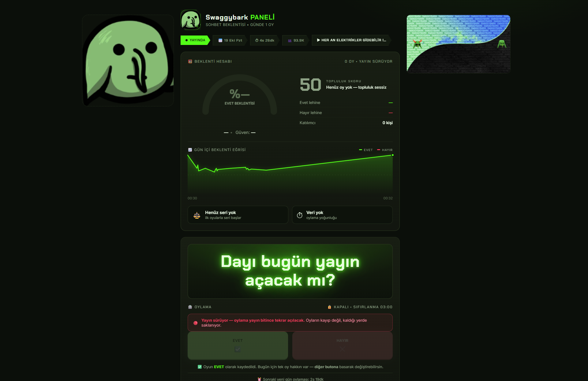

<div align="center">

# 🎮 SWAGGYWATCH

### Swaggybark Kick kanalı için canlı **Evet / Hayır** beklenti paneli

*Kocaman parlak soru • günde 1 oy • yayın açınca otomatik kapanır*

🌐 **Canlı:** https://swgy.swaggywatch.deno.net/
🎬 **OBS Overlay:** https://swgy.swaggywatch.deno.net/overlay
🎛️ **Yayıncı Paneli:** https://swgy.swaggywatch.deno.net/admin



</div>

---

## 📌 Bu ne?

Swaggybark'ın sohbetine açık bir **soru paneli**. Yayıncı bir soru sorar
(*"Dayı bugün yayın açacak mı?"*), sohbetteki herkes **EVET** veya **HAYIR** oyu verir,
panel sonucu herkese anında gösterir.

| | |
|---|---|
| ⏱ **Günde 1 oy** | Her kullanıcı günde tek oy kullanır, oyunu değiştirebilir |
| 🌙 **Gece 03:00 sıfırlama** | Her gece 03:00'da yeni gün açılır, oylar sıfırlanır |
| 🔴 **Yayınla kapanır** | Swaggybark yayına açtığı anda oylama otomatik durur |
| ⚡ **Anlık sonuç** | Oylar anında yansır, ekranda uçuşan `+1` görünür |
| 📺 **OBS desteği** | Yayın ekranına özel `/overlay` sayfası |
| 🖼️ **Reklam alanları** | Panelin iki yanına görsel / GIF eklenebilir |

---

## 👥 İzleyici olarak nasıl kullanılır?

1. Siteye gir → **soru** ekranda kocaman parlak yazı olarak görünür
2. **EVET** veya **HAYIR** butonuna bas
3. Oyun kaydedilir, yüzde ve sayaçlar anında güncellenir
4. Tekrar oy vermek istersen **diğer butona** bas — oyun değiştirilir (toplam oy sayısı değişmez)

> 💡 **İpucu:** Klavyede **E** = EVET, **H** = HAYIR kısayolları çalışır.

### Kurallar

| Kural | Detay |
|---|---|
| 🗳️ Günde 1 oy | Kişi başına günlük tek oy. Oyunu değiştirebilirsin, ikinci oy kullanamazsın |
| 🌙 Sıfırlama | Gece **03:00 (Türkiye saati)** — yeni gün, sıfırdan başlar |
| 🔴 Yayın kuralı | Yayın açıkken oylama **kilitlenir**; yayın bitince **otomatik açılır** |
| 🔒 Gizlilik | IP adresin saklanmaz; sadece şifreli bir özeti (hash) tutulur |

---

## 📺 Yayıncı için rehber

### Panelde ne var?

| Bölüm | Ne işe yarar |
|---|---|
| 🧮 **Beklenti Hesabı** | Büyük **gösterge** (yüzde) + **Topluluk Skoru** (0-100) |
| 📈 **Gün içi eğri** | Topluluğun gün boyunca nasıl değiştiği (ısınıyor mu, soğuyor mu?) |
| 🔥 **Gün serisi** | "3 gündür EVET lehinde" gibi tutarlılık göstergesi |
| 🗳️ **Oylama** | Soru + EVET/HAYIR butonları + anlık `+1` animasyonları |
| 📊 **Bugünün Sonuçları** | Yüzde dağılımı |
| 🗓️ **Geçmiş Günler** | Önceki günlerin kazananı ve kapanış sebebi |

### Topluluk Skoru nasıl hesaplanıyor?

Skor, **oran** ile **veri hacmini** birleştirir. Az oyda 50'ye (kararsız) çekilir, çok oyda
ham orana yaklaşır — böylece **skor asla yüzdeyle çelişmez**:

```
oran  = evet / (evet + hayır)
hacim = min(1, oy sayısı / 25)          // 25 oyda tam hacim
skor  = 50 + (oran×100 − 50) × (0.45 + 0.55 × hacim)
```

Örnek: 7 oyda %71 EVET → skor **63** (*"Topluluk hafif EVET lehinde"*).
25+ oyda %71 EVET → skor **71** (*"Topluluk EVET lehinde eğilimli"*).

### Oyunu değiştirmek

Oyunu verdikten sonra **20 saniye** içinde `✏️ Oyumu Değiştir` butonu görünür.
Butona basınca **10 saniye** içinde oyunu değiştirmen gerekir (butonlar o süre boyunca açılır).
Değiştirdikten sonra 20 saniyelik süre yenilenir → **istediğin kadar kez değiştirebilirsin**.

Tüm zamanlama sunucuda tutulur (`/api/poll/me`), bu yüzden sayfa yenilense bile
kilitlenmezsin.

`/admin` → **"❓ Oylama Sorusu"** → yeni soruyu yaz → **Kaydet**.
Soru panelde ve OBS ekranında anında değişir.

### OBS'a eklemek

1. OBS → **Kaynaklar** → **Tarayıcı** (Browser)
2. URL: `https://siteadresi/overlay` · Genişlik `1920` · Yükseklik `1080`
3. "Yerel dosya" seçme, URL'yi yapıştır

Overlay'da kocaman soru, dev butonlar, yüzde, oy sayısı, sonuç barı ve **uçuşan +1**
animasyonları var. Yayın başlayınca butonlar pasif görünür, "Oylama kapalı" yazar.

### Reklam / GIF eklemek

`/admin` → **"🖼️ Yan Reklam Alanları"**:

- Panelin **sol** ve **sağ** boşluklarına görsel/GIF koyabilirsin
- **Genişlik** (140–520 px), **köşe yuvarlaklığı** ve **opaklık** kaydırıcılarla ayarlanır
- Tıklanınca açılacak **sponsor linki** eklenebilir
- Aynı alanlar OBS overlay'ında da görünür → yayın ekranında sponsor logosu
- Dar ekranlarda (≤1120 px) otomatik gizlenir

### Oylamayı elle yönetmek

`/admin` → **"🎛️ Oylama Durumu"**:

| Buton | Ne yapar |
|---|---|
| 🟢 **Aç** | Yayın sırasında bile oylamayı açık tutar |
| ⏸ **Kapat** | Elle kapatır, yayın bitse bile otomatik açılmaz |
| 🤖 **Otomatik** | Varsayılan davranışa döner (yayın durumuna göre karar verir) |

---

## ❓ Sık Sorulanlar

**Yayın bitince oylama açılıyor mu?**
Evet. Yayın sürerken oylama geçici olarak kapanır (gün içi oylar silinmez), yayın bittiğinde
**aynı günün oylaması otomatik tekrar açılır**.

**Yayın 03:00'ü aşarsa ne olur?**
Yeni gün başlar ama yayın hâlâ açık olduğu için yeni günün oylaması da kapalı olur — kimse
oy veremez (zaten yayındasın). Yayın bittiğinde o günün oylaması açılır. **Hiçbir oy kaybolmaz.**

**Oy değiştirebilir miyim?**
Evet. Gün içinde diğer butona basman yeterli. Toplam oy sayısı değişmez, sadece seçim
değişir.

**Aynı gün içinde tekrar oy kullanabilir miyim?**
Hayır. Günde 1 oy hakkın var. Yeni gün başlayınca (03:00) sıfırdan 1 oy hakkı kazanırsın.

**IP adresim saklanıyor mu?**
Hayır. Kimliğin, IP adresinin `VOTE_SECRET` ile HMAC-SHA256 özetine çevrilerek saklanıyor.
Geri dönüştürülemiyor.

**Geçmiş veriler silinir mi?**
Günler geçmiş günler arşivinde kalır (kazanan, dağılım, kapanış sebebi). Yeni gün oyları
sıfırdan başlar.

---

## 🌍 Canlı Ortam

### ⚠️ Deno Deploy (denendi — kota sınırı)

**🌐 https://swgy.swaggywatch.deno.net/**

Deno Deploy **kredi kartı istemiyor** ve MongoDB bağlantısı sorunsuz çalışıyor
(`npm:mongodb` sürücüsü). Ancak ücretsiz planda **aylık 10 saat aktif CPU** ve
**1M istek** sınırı var. 7/24 açık kalan bir panel (SSE bağlantıları açık
kaldığı için instance sürekli "uyanık") bu kotayı hızlıca tüketir →
`503 USAGE_EXCEEDED` ile askıya alınır.

Bu yüzden **Deno Deploy kalıcı çözüm değil**; aşağıdaki Render önerilir.
Deno, kota sıfırlandığında (ay başı) yeniden çalışır.

### ⭐ Render (kartsız, 24/7, önerilen)

Render'ın ücretsiz planı **kredi kartı istemiyor** ve 7/24 çalışır (750 saat/ay).
`render.yaml` hazır:

1. **https://dashboard.render.com/register** → GitHub ile hesap aç
2. **New → Blueprint** → `ziyamertc/swaggywatch` → servis adı `swaggybark-panel`
3. Ortam değişkenleri:

```
MONGODB_URI   = mongodb+srv://<kullanıcı>:<şifre>@cluster0.<cluster>.mongodb.net/?retryWrites=true&w=majority
MONGODB_DB    = swaggybark
VOTE_SECRET   = <64 karakter>
ADMIN_KEY     = <32 karakter>
KICK_CHANNEL  = swaggybark
KICK_UA       = swaggybark-panel/1.0
```

4. Deploy → `https://swaggybark-panel.onrender.com`

`render.yaml` içindeki **keep-alive cron** 5 dakikada bir ping atarak ücretsiz
planın uykuya dalmasını engeller. Uzun süreli bağlantılar (SSE) Render'da çalışır.

### 📊 Performans notları (CPU kotası için)

Ücretsiz hostlarda CPU kotası sınırlı olduğu için:

| Ayar | Değer | Neden |
|---|---|---|
| Kick durum önbelleği | `KICK_TTL_MS` = 120 sn | Yayın durumu dakikalar içinde değişmez |
| Stale gün kapatma | 60 sn'de bir | Her istekte `updateMany` yapılmasın |
| Snapshot kaydı | 45 sn'de bir | Her istekte `findOne` yapılmasın |
| Ayar önbelleği | 30 sn | Soru + 2 slot her istekte okunmasın |
| İstemci yoklaması | 60 sn | SSE varken yedek ağ |
| SSE ping | 45 sn | Proxy timeout'unu aşmadan bağlantıyı canlı tut |

```bash
npm run load-test http://localhost:3000 30   # istek süresi ölçümü
```

---

## 🛠️ Teknik özet

Nuxt 3 (Nitro) + MongoDB + özel Kick teması (saf CSS, framework bağımlılığı yok).

| Katman | Teknoloji |
|---|---|
| Ön yüz | Nuxt 3, Vue 3, Canvas (gösterge), SVG (trend eğrisi) |
| Sunucu | Nitro API, **SSE** (anlık güncelleme), EventEmitter veriyolu |
| Veritabanı | MongoDB Atlas (`polls`, `snapshots`, `settings`) |
| Yayın algılama | Kick API (30 sn önbellek, nötr User-Agent) |
| Kimlik | IP → HMAC-SHA256 (VOTE_SECRET ile) |

**Önemli not:** Kick'in edge ağı, tarayıcı taklidi yapan User-Agent'ları datacenter IP'lerinden
gelen istekleri 403 ile engelliyor. Bu yüzden bilerek tarayıcı taklidi yapılmıyor.

### Dizin yapısı

```
app.vue                     → Nuxt sarmalayıcı
pages/index.vue             → ana panel
pages/overlay.vue           → OBS overlay'ı (/overlay)
pages/admin.vue             → gizli yayıncı paneli (/admin)
server/api/poll/*.ts        → oylama, soru, slot, kontrol uçları
server/api/stream.get.ts    → SSE (anlık güncelleme)
server/api/admin/*.ts       → admin oturumu (httpOnly cookie)
server/utils/*.ts           → db, oylama servisi, durum makinesi, kick, bus
composables/*.ts            → SSE bağlantısı, uçuşan +1 listesi
shared/utils/day.ts         → TSİ 03:00 gün anahtarı
scripts/*.mjs               → test ve bakım araçları
```

### Testler

```bash
npm test              # 11 gün sınır durumu + 11 durum makinesi senaryosu
npm run test:sse      # SSE gecikme ölçümü
npm run db:check      # MongoDB bağlantı testi
npm run db:dump       # veritabanı içeriğini göster
npm run probe:kick    # Kick API erişim testi
```

---

## 🚀 Kurulum ve Yayınlama

```bash
npm install
cp .env.example .env      # MONGODB_URI, VOTE_SECRET, ADMIN_KEY doldur
npm run db:check
npm run dev               # http://localhost:3000
```

Ücretsiz yayınlama seçenekleri, env değişkenleri ve deploy sonrası kontrol listesi için
**[DEPLOY.md](DEPLOY.md)** dosyasına bak.

| Platform | Durum |
|---|---|
| ⭐ **Northflank Sandbox** | Ücretsiz, **hiç uyumaz** (always-on) — önerilen |
| **Render Hobby** | Ücretsiz (15 dk'da uyur, `render.yaml` keep-alive cron'lu) |
| **Docker** | Cloud Run / Oracle / kendi VPS için |

---

## 📄 Lisans & Notlar

Bu bir **bahis etkinliği değildir** — oran/odds gösterilmez. Puan yerine topluluğun
durumunu anlamlı kılan şeyler vardır: **Topluluk Skoru**, **gün içi eğri** ve **gün serisi**.

Harcanabilir bir puanın anlamlı olması için bir ödül döngüsü (çekiliş, hediye) gerekir;
aksi hâlde puan boş bir sayaftan ibaret kalır.

<div align="center">

**Swaggybark • Kick** · GLHF 🎮

</div>
